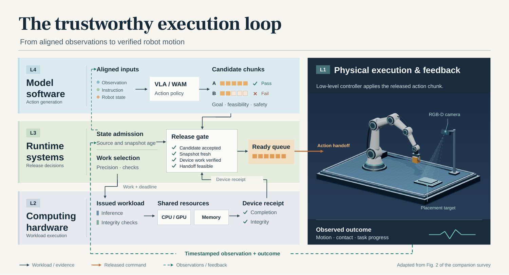
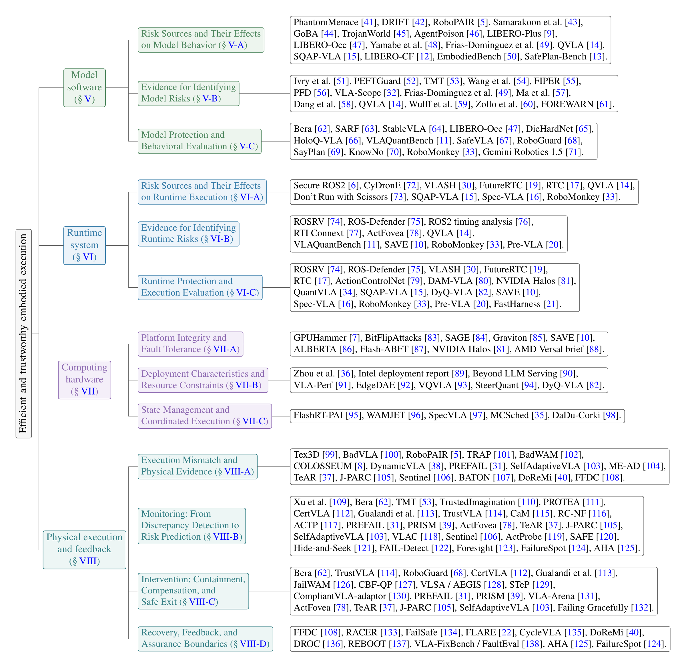
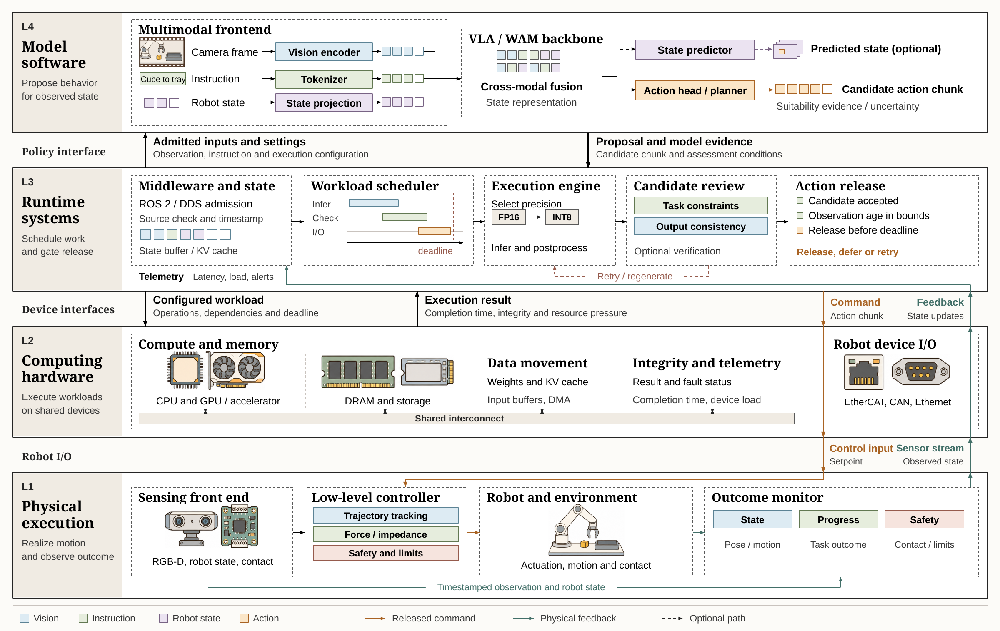
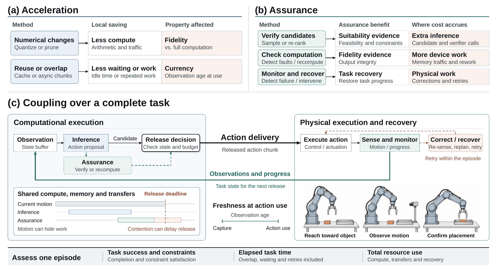
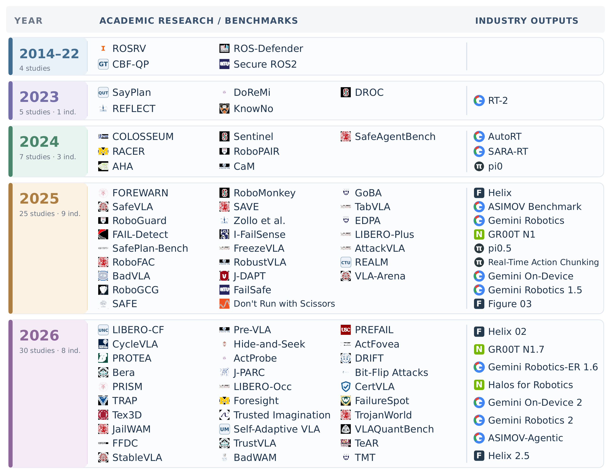
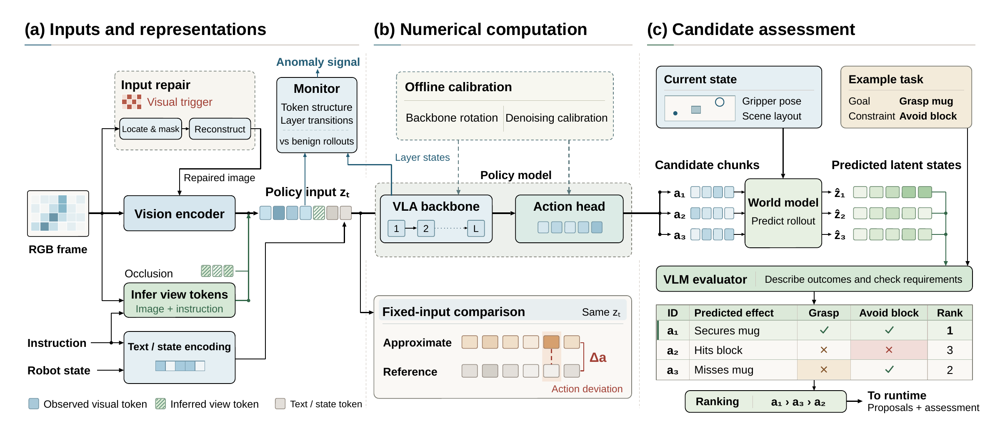
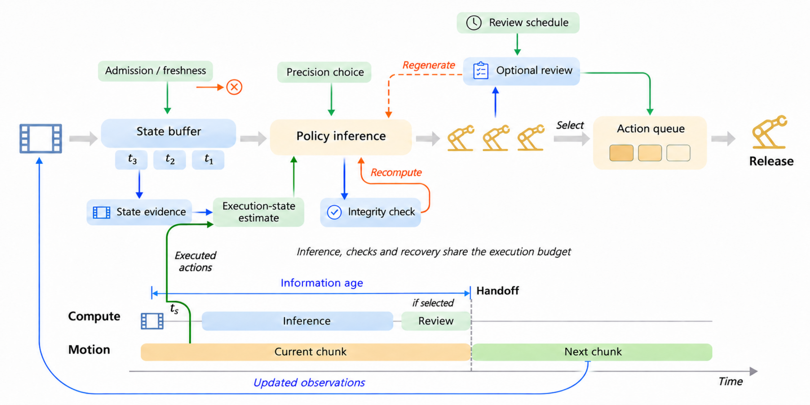
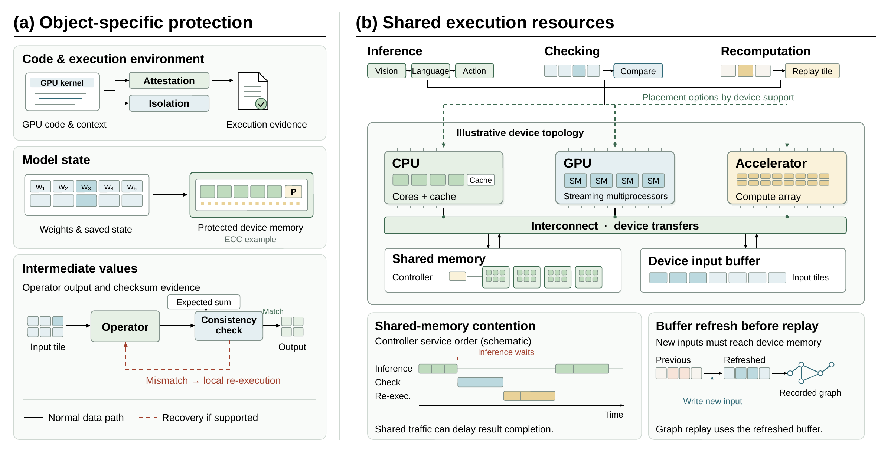
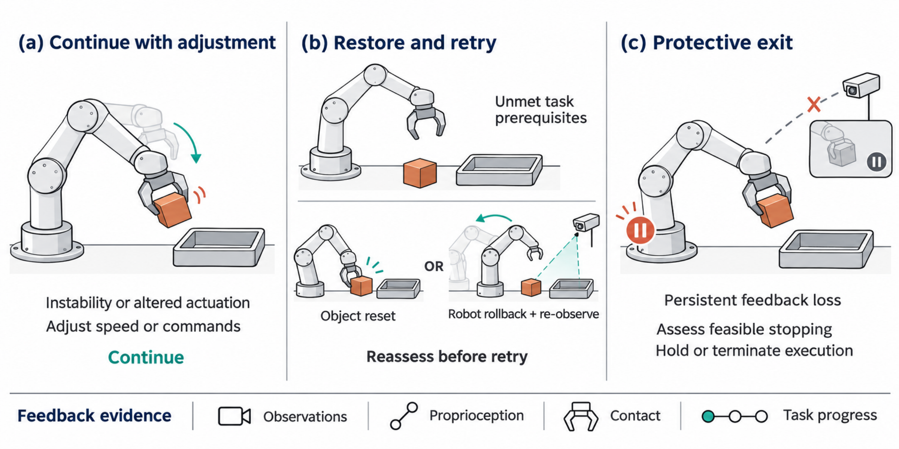

[English](README.md) · **简体中文**

# 🤖 Awesome Embodied Trustworthy Execution



[](https://awesome.re) [](https://github.com/zhengzihaoPKU/Awesome-Embodied-Trustworthy-Execution/stargazers)  [](LICENSE) [](CONTRIBUTING.md)

本仓库是配套综述的学术资源库，收录 VLA、WAM 及相关具身系统中关于 **高效执行、可信保障与跨层协同** 的研究，并依据综述提出的四层系统框架对文献进行逻辑组织。

📄 **配套综述：** *Efficient and Trustworthy Execution of Embodied AI: A Cross-Layer Survey under System-Perspective*.

👥 维护者：[郑子豪](https://github.com/zhengzihaoPKU) · [曹航语](https://github.com/i6bimua) · [毛郅皓](https://github.com/lusunn111)

📚 [完整文献表](data/papers_detailed.csv) · [资源链接](data/paper_links_full.csv) · [收录与维护规则](CONTRIBUTING.md)

<a id="updates"></a>
## 🔥 更新动态

- **2026-11-25**：我们针对综述的新框架对收录文献进行了重组，并优化了仓库展示结构。

<a id="contents"></a>
## 🧭 目录

- [研究范围与分类体系](#about-and-taxonomy)
  - [研究范围](#research-scope)
  - [文献分类图](#literature-taxonomy)
  - [四层系统架构](#system-architecture)
  - [效率与可信权衡](#efficiency-tradeoffs)
- [研究时间线](#research-timeline)
- [背景与相关工作](#background-and-related-work)
  - [相关综述](#section-0-1)
  - [基础模型](#section-0-2)
- [🧠 1. 模型软件](#model-software)
  - [1.1 模型风险来源与行为影响](#section-1-1)
  - [1.2 模型风险评估证据](#section-1-2)
  - [1.3 模型保护与行为评测](#section-1-3)
- [⚙️ 2. 运行时系统](#runtime-systems)
  - [2.1 运行时风险来源与执行影响](#section-2-1)
  - [2.2 运行时风险评估证据](#section-2-2)
  - [2.3 运行时保护与执行评测](#section-2-3)
- [💻 3. 计算硬件](#computing-hardware)
  - [3.1 平台完整性与容错](#section-3-1)
  - [3.2 部署特征与资源约束](#section-3-2)
  - [3.3 状态管理与协同执行](#section-3-3)
- [🦾 4. 物理执行与反馈](#physical-execution-and-feedback)
  - [4.1 物理执行偏差与反馈证据](#section-4-1)
  - [4.2 物理风险监测与预测](#section-4-2)
  - [4.3 执行干预与安全恢复](#section-4-3)
  - [4.4 恢复结果与反馈边界](#section-4-4)
- [5. 评测与基准](#evaluation-and-benchmarks)
  - [5.1 基准与数据集](#section-5-1)
  - [5.2 评测研究](#section-5-2)
- [贡献](#contributing)
- [引用](#citation)
- [致谢与贡献者](#acknowledgements)

<details>
<summary>展开完整三级分类目录</summary>

- [研究范围与分类体系](#about-and-taxonomy)
  - [研究范围](#research-scope)
  - [文献分类图](#literature-taxonomy)
  - [四层系统架构](#system-architecture)
  - [效率与可信权衡](#efficiency-tradeoffs)
- [研究时间线](#research-timeline)
- [背景与相关工作](#background-and-related-work)
  - [相关综述](#section-0-1)
  - [基础模型](#section-0-2)
- [🧠 1. 模型软件](#model-software)
  - [1.1 模型风险来源与行为影响](#section-1-1)
    - [a) 模型输入与资源的恶意操纵](#section-1-1-1)
    - [b) 环境扰动与观测变化](#section-1-1-2)
    - [c) 计算错误与动作偏差](#section-1-1-3)
    - [d) 任务理解与动作生成中的决策异常](#section-1-1-4)
  - [1.2 模型风险评估证据](#section-1-2)
    - [a) 恶意输入与模型失陷检测](#section-1-2-1)
    - [b) 观测偏移与失败风险评估](#section-1-2-2)
    - [c) 计算错误检测与行为敏感性](#section-1-2-3)
    - [d) 任务语义对齐与候选行为质量评估](#section-1-2-4)
  - [1.3 模型保护与行为评测](#section-1-3)
    - [a) 输入修复与表征鲁棒性](#section-1-3-1)
    - [b) 计算扰动鲁棒性](#section-1-3-2)
    - [c) 决策约束与候选验证](#section-1-3-3)
- [⚙️ 2. 运行时系统](#runtime-systems)
  - [2.1 运行时风险来源与执行影响](#section-2-1)
    - [a) 通信中的恶意干扰](#section-2-1-1)
    - [b) 推理与动作交接期间的环境变化](#section-2-1-2)
    - [c) 近似与故障导致的计算偏差](#section-2-1-3)
    - [d) 候选动作释放时的决策异常](#section-2-1-4)
  - [2.2 运行时风险评估证据](#section-2-2)
    - [a) 通信权限与行为检查](#section-2-2-1)
    - [b) 观测时效与状态一致性检查](#section-2-2-2)
    - [c) 配置偏差与计算完整性检查](#section-2-2-3)
    - [d) 候选质量与重新生成证据](#section-2-2-4)
  - [2.3 运行时保护与执行评测](#section-2-3)
    - [a) 通信保护与时序协调](#section-2-3-1)
    - [b) 计算适配与故障恢复](#section-2-3-2)
    - [c) 候选验证与监督调度](#section-2-3-3)
- [💻 3. 计算硬件](#computing-hardware)
  - [3.1 平台完整性与容错](#section-3-1)
    - [a) 可执行代码与模型状态完整性](#section-3-1-1)
    - [b) 瞬态错误检测与恢复](#section-3-1-2)
    - [c) 设备诊断与硬件冗余](#section-3-1-3)
  - [3.2 部署特征与资源约束](#section-3-2)
    - [a) 工作负载特征与部署成本](#section-3-2-1)
    - [b) 近似计算的硬件实现](#section-3-2-2)
  - [3.3 状态管理与协同执行](#section-3-3)
    - [a) 计算状态维护与验证支持](#section-3-3-1)
    - [b) 推理与保障之间的资源竞争](#section-3-3-2)
- [🦾 4. 物理执行与反馈](#physical-execution-and-feedback)
  - [4.1 物理执行偏差与反馈证据](#section-4-1)
    - [a) 经物理交互显现的攻击](#section-4-1-1)
    - [b) 环境变化与本体退化](#section-4-1-2)
    - [c) 局部动作质量与任务进展](#section-4-1-3)
  - [4.2 物理风险监测与预测](#section-4-2)
    - [a) 跨模态与面向攻击的一致性检查](#section-4-2-1)
    - [b) 物理约束与临近危险](#section-4-2-2)
    - [c) 传感器、执行器与反馈完整性](#section-4-2-3)
    - [d) 进度监测与失败定位](#section-4-2-4)
  - [4.3 执行干预与安全恢复](#section-4-3)
    - [a) 从恶意证据到有界动作保护](#section-4-3-1)
    - [b) 安全约束与上下文相关干预](#section-4-3-2)
    - [c) 物理能力变化下的补偿](#section-4-3-3)
  - [4.4 恢复结果与反馈边界](#section-4-4)
    - [a) 局部执行与任务状态恢复](#section-4-4-1)
    - [b) 超越失败检测的恢复评估](#section-4-4-2)
- [5. 评测与基准](#evaluation-and-benchmarks)
  - [5.1 基准与数据集](#section-5-1)
    - [环境与感知鲁棒性](#section-5-1-1)
    - [指令语义对齐与任务规划](#section-5-1-2)
    - [安全与约束满足](#section-5-1-3)
    - [数值保真度与效率](#section-5-1-4)
    - [物理故障与失败严重程度](#section-5-1-5)
    - [失败诊断与恢复](#section-5-1-6)
  - [5.2 评测研究](#section-5-2)
    - [硬件与部署性能](#section-5-2-1)
    - [运行时时序与资源评估](#section-5-2-2)
- [贡献](#contributing)
- [引用](#citation)
- [致谢与贡献者](#acknowledgements)

</details>

<a id="overview"></a>
<a id="about-and-taxonomy"></a>
## 🗺️ 研究范围与分类体系

<a id="research-scope"></a>
### 研究范围

具身系统持续运行在观测、推理、动作与物理反馈构成的闭环中：模型提出候选行为，运行时组织计算和动作释放，硬件提供实际算力与存储，物理交互产生运动及后续观测。攻击、环境变化、计算偏差或决策异常可能沿这一执行链跨层传播；局部加速的收益，也需要连同验证、等待和恢复开销一起评估。

<a id="literature-taxonomy"></a>
### 文献分类图

**系统层级用于定位机制，风险来源用于解释偏差起因，保障属性用于确定需要验证的性质。** 本仓库按四层系统框架对文献进行组织，并根据研究问题与技术方向进行进一步的细分；来源、计算保真度、时效性和任务适用性则作为独立的保障维度。跨层研究可以出现在多个相关方向，下面的分类图可以提供整体检索索引。



*图中的引文号与章节号为论文原编号。*

<a id="system-architecture"></a>
### 四层系统架构

<details>
<summary>展开四层执行架构（Fig. 2）</summary>



</details>

<a id="efficiency-tradeoffs"></a>
### 效率与可信权衡

<details>
<summary>展开效率与可信保障的跨层权衡（Fig. 4）</summary>



</details>

<a id="research-timeline"></a>
## 🕒 研究时间线

从机器人中间件验证与安全控制，到基础模型驱动的行为评估、运行时保障和失效恢复，相关研究逐步覆盖更完整的执行链。下图并列展示代表性学术工作与产业成果，便于了解各类机制的技术背景，以及模型能力、部署效率和执行保障如何相互推动。后续分类列表则按研究问题展开，方便沿具体方向继续查阅。



*按首次公开时间展示代表性研究与产业成果（论文 Fig. 1）。*

<a id="surveys-and-foundations"></a>
<a id="background-and-related-work"></a>
## 📚 背景与相关工作

相关综述提供问题定义与研究脉络，基础模型则提供典型的行为生成和预测架构。本节作为阅读后续四层技术分类的背景入口。

<a id="section-0-1"></a>
### 相关综述

- <a id="p007"></a>**A Survey on Efficient Vision-Language-Action Models**. (2026, IEEE TPAMI (accepted)) [](https://arxiv.org/abs/2510.24795) [](https://evla-survey.github.io/)
- <a id="p004"></a>**Embodied Intelligence Security with Vision-language Models: A Survey**. (2026, MIR) [](https://doi.org/10.1007/s11633-025-1626-x)
- <a id="p006"></a>**From Bits to Atoms: A survey of cross-layer safety in Embodied AI**. (2026, arXiv) [](https://arxiv.org/abs/2610.14038)
- <a id="p002"></a>**Large-scale multimodal model based embodied intelligent robots: A survey**. (2026, EAAI) [](https://doi.org/10.1016/j.engappai.2025.112991)
- <a id="p005"></a>**Safety in Embodied AI**: A Survey of Risks, Attacks, and Defenses. (2026, arXiv) [](https://arxiv.org/abs/2605.02900) [](https://x-zheng16.github.io/Awesome-Embodied-AI-Safety/)
- <a id="p003"></a>**Towards Robust and Secure Embodied AI: A Survey on Vulnerabilities and Attacks**. (2026, ACM CSUR) [](https://doi.org/10.1145/3806048)
- <a id="p001"></a>**A Survey on Robotics with Foundation Models: toward Embodied AI**. (2024, arXiv) [](https://arxiv.org/abs/2402.02385)

<a id="section-0-2"></a>
### 基础模型

- <a id="p011"></a>**World Action Models are Zero-shot Policies**. (2026, arXiv) [](https://arxiv.org/abs/2602.15922) [](https://github.com/dreamzero0/dreamzero) [](https://dreamzero0.github.io/)
- <a id="p009"></a>**OpenVLA**: An Open-Source Vision-Language-Action Model. (2025, CoRL) [](https://proceedings.mlr.press/v270/kim25c.html) [](https://github.com/openvla/openvla) [](https://openvla.github.io/)
- <a id="p010"></a>**GR-2**: A Generative Video-Language-Action Model with Web-Scale Knowledge for Robot Manipulation. (2024, arXiv) [](https://arxiv.org/abs/2410.06158) [](https://gr2-manipulation.github.io/)
- <a id="p008"></a>**Octo**: An Open-Source Generalist Robot Policy. (2024, RSS) [](https://doi.org/10.15607/RSS.2024.XX.090) [](https://github.com/octo-models/octo) [](https://octo-models.github.io/)

<a id="model-software"></a>
## 🧠 1. 模型软件

模型层关注观测与任务要求如何转化为表征、预测和候选动作。本节从输入操纵、观测扰动、计算偏差及决策异常出发，整理风险识别、输入与表征保护、数值鲁棒性和候选验证等研究，重点区分模型对指定计算的保真度与所生成行为对任务的适用性。

<a id="section-1-4"></a>

<details>
<summary>本层机制图（Fig. 5）</summary>



</details>

<a id="section-1-1"></a>
### 1.1 模型风险来源与行为影响

<a id="section-1-1-1"></a>
#### a) 模型输入与资源的恶意操纵

- <a id="p013"></a>**DRIFT**: Derailing Denoising Trajectories of Flow-Matching VLAs with Adversarial Patch Attack. (2026, arXiv) [](https://arxiv.org/abs/2608.03207) [](https://github.com/TaeHoseong/DRIFT) [](https://taehoseong.github.io/DRIFT/)
- <a id="p015"></a>**Hijacking Robots with a Piece of Paper: A Systematic Study of Physical Prompt Injection in VLM-Controlled Robots**. (2026, arXiv) [](https://arxiv.org/abs/2608.05715)
- <a id="p012"></a>**Phantom Menace**: Exploring and Enhancing the Robustness of VLA Models Against Physical Sensor Attacks. (2026, AAAI) [](https://arxiv.org/abs/2511.10008) [](https://github.com/ZJUshine/Phantom-Menace)
- <a id="p017"></a>**TrojanWorld**: Backdooring World-Model Agents via Imagination Steering. (2026, arXiv) [](https://arxiv.org/abs/2609.07051)
- <a id="p016"></a>**Goal-oriented backdoor attack against vision-language-action models via physical objects**. (2025, arXiv) [](https://arxiv.org/abs/2510.09269) [](https://github.com/trustmlyoungscientist/GoBA_attack) [](https://goba-attack.github.io/)
- <a id="p014"></a>**RoboPAIR**: Jailbreaking LLM-Controlled Robots. (2025, ICRA) [](https://doi.org/10.1109/ICRA55743.2025.11128119) [](https://github.com/arobey1/robopair) [](https://robopair.org/)
- <a id="p018"></a>**AgentPoison**: Red-teaming LLM Agents via Poisoning Memory or Knowledge Bases. (2024, NeurIPS) [](https://arxiv.org/abs/2407.12784) [](https://github.com/AI-secure/AgentPoison)

<a id="section-1-1-2"></a>
#### b) 环境扰动与观测变化

- <a id="p021"></a>**Are Vision-Language-Action Models Robust to One-Step Observation Perturbations?** (2026, arXiv) [](https://arxiv.org/abs/2609.32550)
- <a id="p020"></a>**LIBERO-Occ**: Evaluating and Improving Vision-Language-Action Models under Scene-Induced Occlusion via Viewpoint Imagination. (2026, arXiv) [](https://arxiv.org/abs/2606.10862) [](https://github.com/litsh/Libero-Occ)
- <a id="p019"></a>**LIBERO-Plus**: In-depth Robustness Analysis of Vision-Language-Action Models. (2025, arXiv) [](https://arxiv.org/abs/2510.13626) [](https://github.com/sylvestf/LIBERO-plus) [](https://sylvestf.github.io/LIBERO-plus/)

<a id="section-1-1-3"></a>
#### c) 计算错误与动作偏差

- <a id="p022"></a>**Dependability analysis and hardening of vision transformers against soft errors**. (2026, J. Supercomputing) [](https://doi.org/10.1007/s11227-026-08373-0) [](https://github.com/lesterfd95/vit-fi)
- <a id="p023"></a>**QVLA**: Not All Channels Are Equal in Vision-Language-Action Model's Quantization. (2026, arXiv) [](https://arxiv.org/abs/2602.03782) [](https://github.com/AutoLab-SAI-SJTU/QVLA)
- <a id="p024"></a>**SQAP-VLA**: A Synergistic Quantization-Aware Pruning Framework for High-Performance Vision-Language-Action Models. (2025, arXiv) [](https://arxiv.org/abs/2509.09090) [](https://github.com/ecdine/SQAP-VLA)

<a id="section-1-1-4"></a>
#### d) 任务理解与动作生成中的决策异常

- <a id="p025"></a>**LIBERO-CF**: When Vision Overrides Language: Evaluating and Mitigating Counterfactual Failures in VLAs. (2026, CoRL) [](https://arxiv.org/abs/2602.17659) [](https://github.com/yuffish/VLA-CF) [](https://vla-cf.github.io/)
- <a id="p027"></a>**SafePlan-Bench**: A Framework for Benchmarking and Aligning Task-Planning Safety in LLM-Based Embodied Agents. (2025, arXiv) [](https://arxiv.org/abs/2504.14650)
- <a id="p026"></a>**EmbodiedBench**: Comprehensive Benchmarking Multi-modal Large Language Models for Vision-Driven Embodied Agents. (2025, ICML) [](https://proceedings.mlr.press/v267/yang25f.html) [](https://github.com/EmbodiedBench/EmbodiedBench) [](https://embodiedbench.github.io/)

<a id="section-1-2"></a>
### 1.2 模型风险评估证据

<a id="section-1-2-1"></a>
#### a) 恶意输入与模型失陷检测

- <a id="p030"></a>**TMT**: Runtime Backdoor Detection for Vision-Language-Action Policies on Unseen Tasks. (2026, arXiv) [](https://arxiv.org/abs/2610.09462) [](https://zzr42.github.io/tmt/)
- <a id="p029"></a>**PEFTGuard**: Detecting Backdoor Attacks Against Parameter-Efficient Fine-Tuning. (2025, IEEE S&P) [](https://arxiv.org/abs/2411.17453) [](https://github.com/Vincent-HKUSTGZ/PEFTGuard)
- <a id="p028"></a>**Sentinel: Sota model to protect against prompt injections**. (2025, arXiv) [](https://arxiv.org/abs/2506.05446) [](https://huggingface.co/qualifire/prompt-injection-sentinel)

<a id="section-1-2-2"></a>
#### b) 观测偏移与失败风险评估

- <a id="p033"></a>**PFD**: Perturbation-Based Epistemic Uncertainty for Failure Detection in Vision-Language-Action Models. (2026, arXiv) [](https://arxiv.org/abs/2606.20754)
- <a id="p034"></a>**VLA-Scope**: Shift-Aware Failure Prediction for Vision-Language-Action Models. (2026, arXiv) [](https://arxiv.org/abs/2609.21246)
- <a id="p031"></a>**Are vision language models robust to uncertain inputs?** (2025, arXiv) [](https://arxiv.org/abs/2505.11804)
- <a id="p032"></a>**FIPER**: Failure Prediction at Runtime for Generative Robot Policies. (2025, NeurIPS) [](https://arxiv.org/abs/2510.09459) [](https://github.com/learnsyslab/fiper) [](https://tum-lsy.github.io/fiper_website/)

<a id="section-1-2-3"></a>
#### c) 计算错误检测与行为敏感性

- **Dependability analysis and hardening of vision transformers against soft errors**. (2026, J. Supercomputing) [](https://doi.org/10.1007/s11227-026-08373-0) [](https://github.com/lesterfd95/vit-fi)
- <a id="p035"></a>**Error-Resilient Transformers: A Novel Soft Error Vulnerability Guided Approach to Error Checking and Suppression**. (2026, JETTA) [](https://doi.org/10.1007/s10836-026-06227-4)
- **QVLA**: Not All Channels Are Equal in Vision-Language-Action Model's Quantization. (2026, arXiv) [](https://arxiv.org/abs/2602.03782) [](https://github.com/AutoLab-SAI-SJTU/QVLA)
- <a id="p036"></a>**Certifiably Quantisation-Robust training and inference of Neural Networks**. (2025, AISTATS) [](https://proceedings.mlr.press/v258/dang25a.html) [](https://github.com/danghue18/Certifiably-Quantisation-Robust-training-and-inference)

<a id="section-1-2-4"></a>
#### d) 任务语义对齐与候选行为质量评估

- <a id="p037"></a>**Do Vision-Language-Action Models Understand Instructions? A Mechanistic Interpretability Study on Language Grounding**. (2026, arXiv) [](https://arxiv.org/abs/2610.10178)
- <a id="p038"></a>**Confidence Calibration in Vision-Language-Action Models**. (2025, arXiv) [](https://arxiv.org/abs/2507.17383) [](https://github.com/thomaspzollo/vla_calibration)
- <a id="p039"></a>**FOREWARN**: From foresight to forethought: VLM-in-the-loop policy steering via latent alignment. (2025, arXiv) [](https://arxiv.org/abs/2502.01828) [](https://github.com/CMU-IntentLab/Forewarn) [](https://yilin-wu98.github.io/forewarn/)

<a id="section-1-3"></a>
### 1.3 模型保护与行为评测

<a id="section-1-3-1"></a>
#### a) 输入修复与表征鲁棒性

- **LIBERO-Occ**: Evaluating and Improving Vision-Language-Action Models under Scene-Induced Occlusion via Viewpoint Imagination. (2026, arXiv) [](https://arxiv.org/abs/2606.10862) [](https://github.com/litsh/Libero-Occ)
- <a id="p042"></a>**StableVLA**: Towards Robust Vision-Language-Action Models without Extra Data. (2026, arXiv) [](https://arxiv.org/abs/2605.18287) [](https://github.com/DAGroup-PKU/HumanNet) [](https://dagroup-pku.github.io/StableVLA/)
- <a id="p041"></a>**SARF**: Structure-Aware Robust Fine-Tuning: Defending Vision-Language-Action Robots Against Physical Attention Hijacking. (2026, IROS) [](https://arxiv.org/abs/2608.03231)
- <a id="p040"></a>**Bera**: When attention betrays: Erasing backdoor attacks in robotic policies by reconstructing visual tokens. (2026, ICRA) [](https://arxiv.org/abs/2602.03153)

<a id="section-1-3-2"></a>
#### b) 计算扰动鲁棒性

- <a id="p044"></a>**HoloQ-VLA**: Uniform W4A4 quantization of vision-language-action models. (2026, arXiv) [](https://arxiv.org/abs/2605.28803)
- <a id="p045"></a>**VLAQuantBench**: Closed-Loop Evaluation of Post-Training Quantization for Vision-Language-Action Models. (2026, arXiv) [](https://arxiv.org/abs/2609.25376) [](https://github.com/jiuyixu25/VLAQuantBench)
- <a id="p043"></a>**DieHardNet**: Improving Deep Neural Network Reliability via Transient-Fault-Aware Design and Training. (2025, IEEE TETC) [](https://doi.org/10.1109/TETC.2024.3520672) [](https://github.com/diehardnet/diehardnet)

<a id="section-1-3-3"></a>
#### c) 决策约束与候选验证

- <a id="p047"></a>**RoboGuard**: Safety Guardrails for LLM-Enabled Robots. (2026, IEEE RA-L) [](https://arxiv.org/abs/2503.07885) [](https://github.com/KumarRobotics/RoboGuard) [](https://robo-guard.github.io/)
- <a id="p051"></a>**Gemini Robotics 1.5**: Pushing the Frontier of Generalist Robots with Advanced Embodied Reasoning, Thinking, and Motion Transfer. (2025, arXiv) [](https://arxiv.org/abs/2510.03342) [](https://deepmind.google/blog/gemini-robotics-15-brings-ai-agents-into-the-physical-world/)
- <a id="p050"></a>**RoboMonkey**: Scaling test-time sampling and verification for vision-language-action models. (2025, arXiv) [](https://arxiv.org/abs/2506.17811) [](https://github.com/robomonkey-vla/RoboMonkey) [](https://robomonkey-vla.github.io/)
- <a id="p046"></a>**SafeVLA**: Towards Safety Alignment of Vision-Language-Action Model via Constrained Learning. (2025, NeurIPS) [](https://proceedings.neurips.cc/paper_files/paper/2025/file/e185c7be603426028c32ae1003a59d78-Paper-Conference.pdf) [](https://github.com/PKU-Alignment/SafeVLA) [](https://safevla.github.io/)
- <a id="p049"></a>**KnowNo**: Robots that ask for help: Uncertainty alignment for large language model planners. (2023, arXiv) [](https://arxiv.org/abs/2307.01928) [](https://github.com/google-research/google-research/tree/master/language_model_uncertainty) [](https://robot-help.github.io/)
- <a id="p048"></a>**SayPlan**: Grounding Large Language Models using 3D Scene Graphs for Scalable Task Planning. (2023, CoRL) [](https://openreview.net/forum?id=wMpOMO0Ss7a) [](https://sayplan.github.io/)

<a id="runtime-systems"></a>
## ⚙️ 2. 运行时系统

运行时将模型给出的评估证据转化为执行决策：接纳哪些更新、采用何种计算配置、何时检查或重新生成，以及何时释放动作。本节围绕通信权限、观测时效、计算完整性和候选质量展开，关注推理、验证与正在执行的动作如何在有限预算和响应期限内协调。

<a id="section-2-4"></a>

<details>
<summary>本层机制图（Fig. 6）</summary>



</details>

<a id="section-2-1"></a>
### 2.1 运行时风险来源与执行影响

<a id="section-2-1-1"></a>
#### a) 通信中的恶意干扰

- <a id="p053"></a>**Cybersecurity Simulation Environment for Drones in Naval Applications**. (2026, Autonomous Sea Navigation) [](https://doi.org/10.3233/NICSP260010)
- <a id="p052"></a>**On the (In)Security of Secure ROS2**. (2022, ACM CCS) [](https://sites.google.com/view/secure-sros2/home) [](https://github.com/victomteng1997/SROS2_Broadcast_Encryption)

<a id="section-2-1-2"></a>
#### b) 推理与动作交接期间的环境变化

- <a id="p055"></a>**FutureRTC**: Real-Time Robot Execution with Anticipatory-Conditioned Action Chunking. (2026, arXiv) [](https://arxiv.org/abs/2607.24008) [](https://jianghaiscu.github.io/FutureRTC_proj/)
- <a id="p056"></a>**RTC**: Real-Time Execution of Action Chunking Flow Policies. (2025, NeurIPS) [](https://proceedings.neurips.cc/paper_files/paper/2025/file/300ccb2187dedd4edcc07f7e76d8e553-Paper-Conference.pdf) [](https://github.com/Physical-Intelligence/real-time-chunking-kinetix) [](https://pi.website/research/real_time_chunking)
- <a id="p054"></a>**VLASH**: Real-Time VLAs via Future-State-Aware Asynchronous Inference. (2025, arXiv) [](https://arxiv.org/abs/2512.01031) [](https://github.com/mit-han-lab/vlash)

<a id="section-2-1-3"></a>
#### c) 近似与故障导致的计算偏差

- **QVLA**: Not All Channels Are Equal in Vision-Language-Action Model's Quantization. (2026, arXiv) [](https://arxiv.org/abs/2602.03782) [](https://github.com/AutoLab-SAI-SJTU/QVLA)
- <a id="p057"></a>**Don't Run with Scissors: Pruning Breaks VLA Models but They Can Be Recovered**. (2025, arXiv) [](https://arxiv.org/abs/2510.08464) [](https://gluestick-vla.github.io/)
- <a id="p058"></a>**Spec-VLA**: Speculative Decoding for Vision-Language-Action Models with Relaxed Acceptance. (2025, EMNLP) [](https://aclanthology.org/2025.emnlp-main.1367/) [](https://github.com/PineTreeWss/SpecVLA)
- **SQAP-VLA**: A Synergistic Quantization-Aware Pruning Framework for High-Performance Vision-Language-Action Models. (2025, arXiv) [](https://arxiv.org/abs/2509.09090) [](https://github.com/ecdine/SQAP-VLA)

<a id="section-2-1-4"></a>
#### d) 候选动作释放时的决策异常

- **RoboMonkey**: Scaling test-time sampling and verification for vision-language-action models. (2025, arXiv) [](https://arxiv.org/abs/2506.17811) [](https://github.com/robomonkey-vla/RoboMonkey) [](https://robomonkey-vla.github.io/)

<a id="section-2-2"></a>
### 2.2 运行时风险评估证据

<a id="section-2-2-1"></a>
#### a) 通信权限与行为检查

- <a id="p060"></a>**ROS-Defender**: SDN-Based Security Policy Enforcement for Robotic Applications. (2019, IEEE SPW) [](https://orbilu.uni.lu/handle/10993/39887)
- <a id="p059"></a>**ROSRV**: Runtime Verification for Robots. (2014, RV) [](https://doi.org/10.1007/978-3-319-11164-3_20) [](https://github.com/cansuerdogan/ROSRV)

<a id="section-2-2-2"></a>
#### b) 观测时效与状态一致性检查

- <a id="p063"></a>**ActFovea**: Runtime safeguarding for VLA policies via spatiotemporal visual-action consistency. (2026, arXiv) [](https://arxiv.org/abs/2607.29169) [](https://github.com/SunnyYWD/ActFovea)
- <a id="p062"></a>**RTI Connext QoS Reference Guide**. (2026, RTI documentation) [](https://community.rti.com/static/documentation/connext-dds/7.7.0/doc/manuals/connext_dds_professional/qos_reference/qos_reference/BasicQoS.htm)
- <a id="p061"></a>**End-to-end timing analysis in ROS2**. (2022, RTSS) [](https://daes.cs.tu-dortmund.de/storages/daes-cs/r/publications/teper_rtss_2022.pdf) [](https://github.com/HarunTeper/ros2-end-to-end)

<a id="section-2-2-3"></a>
#### c) 配置偏差与计算完整性检查

- **QVLA**: Not All Channels Are Equal in Vision-Language-Action Model's Quantization. (2026, arXiv) [](https://arxiv.org/abs/2602.03782) [](https://github.com/AutoLab-SAI-SJTU/QVLA)
- **VLAQuantBench**: Closed-Loop Evaluation of Post-Training Quantization for Vision-Language-Action Models. (2026, arXiv) [](https://arxiv.org/abs/2609.25376) [](https://github.com/jiuyixu25/VLAQuantBench)
- <a id="p064"></a>**SAVE**: Software-Implemented Fault Tolerance for Model Inference against GPU Memory Bit Flips. (2025, USENIX ATC) [](https://www.usenix.org/conference/atc25/presentation/zheng) [](https://github.com/peterzheng98/gpu-memory)

<a id="section-2-2-4"></a>
#### d) 候选质量与重新生成证据

- <a id="p065"></a>**Pre-VLA**: Preemptive Runtime Verification for Reliable Vision-Language-Action and World-Model Rollouts. (2026, arXiv) [](https://arxiv.org/abs/2605.22446)
- **RoboMonkey**: Scaling test-time sampling and verification for vision-language-action models. (2025, arXiv) [](https://arxiv.org/abs/2506.17811) [](https://github.com/robomonkey-vla/RoboMonkey) [](https://robomonkey-vla.github.io/)

<a id="section-2-3"></a>
### 2.3 运行时保护与执行评测

<a id="section-2-3-1"></a>
#### a) 通信保护与时序协调

- <a id="p066"></a>**Action ControlNet**: A Lightweight Delay-Aware Adapter for Smooth Asynchronous Control in Vision-Language-Action Models. (2026, arXiv) [](https://arxiv.org/abs/2606.25985)
- <a id="p067"></a>**DAM-VLA**: Decoupled Asynchronous Multimodal Vision Language Action model. (2026, arXiv) [](https://arxiv.org/abs/2606.12105) [](https://intuitive-robots.github.io/DAM-VLA/)
- **FutureRTC**: Real-Time Robot Execution with Anticipatory-Conditioned Action Chunking. (2026, arXiv) [](https://arxiv.org/abs/2607.24008) [](https://jianghaiscu.github.io/FutureRTC_proj/)
- <a id="p068"></a>**Inside NVIDIA Halos for Robotics: A Full-Stack Functional Safety System for Physical AI**. (2026, NVIDIA Technical Blog) [](https://developer.nvidia.com/blog/inside-nvidia-halos-for-robotics-a-full-stack-functional-safety-system-for-physical-ai/) [](https://github.com/NVIDIA/halos-outside-in-safety)
- <a id="p072"></a>**Latency-Tolerant Cloud-Edge Collaborative Vision-Language-Action Models via Emergent Representational Specialization**. (2026, arXiv) [](https://arxiv.org/abs/2608.00569) [](https://daojiepeng.github.io/CloudEdgeVLA/)
- **RTC**: Real-Time Execution of Action Chunking Flow Policies. (2025, NeurIPS) [](https://proceedings.neurips.cc/paper_files/paper/2025/file/300ccb2187dedd4edcc07f7e76d8e553-Paper-Conference.pdf) [](https://github.com/Physical-Intelligence/real-time-chunking-kinetix) [](https://pi.website/research/real_time_chunking)
- **VLASH**: Real-Time VLAs via Future-State-Aware Asynchronous Inference. (2025, arXiv) [](https://arxiv.org/abs/2512.01031) [](https://github.com/mit-han-lab/vlash)
- **ROS-Defender**: SDN-Based Security Policy Enforcement for Robotic Applications. (2019, IEEE SPW) [](https://orbilu.uni.lu/handle/10993/39887)
- **ROSRV**: Runtime Verification for Robots. (2014, RV) [](https://doi.org/10.1007/978-3-319-11164-3_20) [](https://github.com/cansuerdogan/ROSRV)

<a id="section-2-3-2"></a>
#### b) 计算适配与故障恢复

- <a id="p070"></a>**DyQ-VLA**: Temporal-Dynamic-Aware Quantization for Embodied Vision-Language-Action Models. (2026, arXiv) [](https://arxiv.org/abs/2603.07904) [](https://anonymous.4open.science/r/DyQ-VLA-7F51/)
- <a id="p069"></a>**QuantVLA**: Scale-Calibrated Post-Training Quantization for Vision-Language-Action Models. (2026, arXiv) [](https://arxiv.org/abs/2602.20309) [](https://github.com/AIoT-MLSys-Lab/QuantVLA) [](https://quantvla.github.io/)
- **SAVE**: Software-Implemented Fault Tolerance for Model Inference against GPU Memory Bit Flips. (2025, USENIX ATC) [](https://www.usenix.org/conference/atc25/presentation/zheng) [](https://github.com/peterzheng98/gpu-memory)
- **SQAP-VLA**: A Synergistic Quantization-Aware Pruning Framework for High-Performance Vision-Language-Action Models. (2025, arXiv) [](https://arxiv.org/abs/2509.09090) [](https://github.com/ecdine/SQAP-VLA)

<a id="section-2-3-3"></a>
#### c) 候选验证与监督调度

- <a id="p071"></a>**FastHarness**: Experience-Driven Review Scheduling for Vision-Language-Action Policies. (2026, arXiv) [](https://arxiv.org/abs/2610.31427) [](https://github.com/FastHarness/fast-harness)
- **Pre-VLA**: Preemptive Runtime Verification for Reliable Vision-Language-Action and World-Model Rollouts. (2026, arXiv) [](https://arxiv.org/abs/2605.22446)
- **RoboMonkey**: Scaling test-time sampling and verification for vision-language-action models. (2025, arXiv) [](https://arxiv.org/abs/2506.17811) [](https://github.com/robomonkey-vla/RoboMonkey) [](https://robomonkey-vla.github.io/)
- **Spec-VLA**: Speculative Decoding for Vision-Language-Action Models with Relaxed Acceptance. (2025, EMNLP) [](https://aclanthology.org/2025.emnlp-main.1367/) [](https://github.com/PineTreeWss/SpecVLA)

<a id="computing-hardware"></a>
## 💻 3. 计算硬件

计算硬件决定推理与保障工作负载能否可靠、及时地完成。本节涵盖代码和模型状态完整性、瞬态故障检测与恢复，以及异构部署、状态复用和共享资源协调。这些研究的比较需要同时考虑保护对象、设备假设及数据移动成本。

<a id="section-3-4"></a>
推理与保障工作需要联合考虑设备能力、数据移动和响应时间。

<details>
<summary>本层机制图（Fig. 7）</summary>



</details>

<a id="section-3-1"></a>
### 3.1 平台完整性与容错

<a id="section-3-1-1"></a>
#### a) 可执行代码与模型状态完整性

- <a id="p074"></a>**Bit-Flip Attacks on Vision-Language-Action Models: Action-Decoding Architecture Shapes the Vulnerability**. (2026, arXiv) [](https://arxiv.org/abs/2608.15475) [](https://arxiv.org/src/2608.15475v3/anc)
- <a id="p073"></a>**GPUHammer**: Rowhammer Attacks on GPU Memories are Practical. (2025, USENIX Security) [](https://www.usenix.org/conference/usenixsecurity25/presentation/lin-shaopeng) [](https://github.com/sith-lab/gpuhammer) [](https://www.gpuhammer.com/)
- <a id="p075"></a>**SAGE**: Software-based Attestation for GPU Execution. (2023, USENIX ATC) [](https://www.usenix.org/conference/atc23/presentation/ivanov) [](https://github.com/spcl/sage)
- <a id="p076"></a>**Graviton**: Trusted Execution Environments on GPUs. (2018, OSDI) [](https://www.usenix.org/conference/osdi18/presentation/volos)

<a id="section-3-1-2"></a>
#### b) 瞬态错误检测与恢复

- <a id="p078"></a>**Flash-ABFT**: Custom Algorithm-based Fault Tolerance for Attention Layers in Transformers. (2025, IEEE SOCC) [](https://arxiv.org/abs/2507.16676)
- **SAVE**: Software-Implemented Fault Tolerance for Model Inference against GPU Memory Bit Flips. (2025, USENIX ATC) [](https://www.usenix.org/conference/atc25/presentation/zheng) [](https://github.com/peterzheng98/gpu-memory)
- <a id="p077"></a>**ALBERTA**: ALgorithm-Based Error Resilience in Transformer Architectures. (2024, arXiv) [](https://arxiv.org/abs/2310.03841)

<a id="section-3-1-3"></a>
#### c) 设备诊断与硬件冗余

- **Inside NVIDIA Halos for Robotics: A Full-Stack Functional Safety System for Physical AI**. (2026, NVIDIA Technical Blog) [](https://developer.nvidia.com/blog/inside-nvidia-halos-for-robotics-a-full-stack-functional-safety-system-for-physical-ai/) [](https://github.com/NVIDIA/halos-outside-in-safety)
- <a id="p079"></a>**AI-Driven Industrial Automation with AMD Versal AI Edge Series Gen 2**. (2024, AMD technical brief) [](https://www.amd.com/content/dam/amd/en/documents/products/adaptive-socs-and-fpgas/versal/versal-ai-edge-gen2-industrial-solution-brief.pdf)

<a id="section-3-2"></a>
### 3.2 部署特征与资源约束

<a id="section-3-2-1"></a>
#### a) 工作负载特征与部署成本

- <a id="p082"></a>**Beyond LLM Serving**: Characterizing Vision-Language-Action Workloads for Embodied AI System Design. (2026, arXiv) [](https://arxiv.org/abs/2610.05062)
- <a id="p080"></a>**Characterizing Vision-Language-Action Models across XPUs: Constraints and Acceleration for On-Robot Deployment**. (2026, arXiv) [](https://arxiv.org/abs/2604.24447) [](https://vla-leaderboard-01.vercel.app/)
- <a id="p083"></a>**How Fast Can I Run My VLA? Demystifying VLA Inference Performance with VLA-Perf**. (2026, arXiv) [](https://arxiv.org/abs/2602.18397) [](https://github.com/NVlabs/vla-perf)
- <a id="p081"></a>**Optimizing π0.5 Vision-Language-Action Robotic Model on Intel Core Ultra Series 3 Processor**. (2026, Intel technical article) [](https://docs.openedgeplatform.intel.com/2026.2/OEP-articles/publications/optimizing-pi0.5-lva-model.html)

<a id="section-3-2-2"></a>
#### b) 近似计算的硬件实现

- <a id="p085"></a>**VQVLA**: A Motion-Aware Vector Quantization Framework with Centroid Reuse for Efficient VLA Inference. (2026, arXiv) [](https://arxiv.org/abs/2607.24148)
- **DyQ-VLA**: Temporal-Dynamic-Aware Quantization for Embodied Vision-Language-Action Models. (2026, arXiv) [](https://arxiv.org/abs/2603.07904) [](https://anonymous.4open.science/r/DyQ-VLA-7F51/)
- <a id="p084"></a>**EdgeDAE**: Acceleration of Diffusion Action Experts for Real-Time Physical AI with Tiny VLAs on Edge FPGA-GPU Systems. (2026, arXiv) [](https://arxiv.org/abs/2610.00311)
- <a id="p086"></a>**SteerQuant**: Steering Quantization Error with Action-Guided Scaling in World-Action Models. (2026, arXiv) [](https://arxiv.org/abs/2609.39056)

<a id="section-3-3"></a>
### 3.3 状态管理与协同执行

<a id="section-3-3-1"></a>
#### a) 计算状态维护与验证支持

- <a id="p089"></a>**SpecVLA**: Algorithm-Architecture Co-Design for Efficient VLA Inference via Speculative Inference and Verification. (2026, arXiv) [](https://arxiv.org/abs/2608.15636)
- <a id="p087"></a>**FlashRT-PAI**: Fast Kernels Are Not Fast Pipelines for Physical AI Inference. (2026, arXiv) [](https://arxiv.org/abs/2610.24349) [](https://github.com/flashrt-project/FlashRT)
- <a id="p088"></a>**WAMJET**: A Harness for World Action Model Acceleration. (2026, arXiv) [](https://arxiv.org/abs/2610.03797) [](https://github.com/liulixinkerry/WAMJET) [](https://liulixinkerry.github.io/WAMJET/index.html)

<a id="section-3-3-2"></a>
#### b) 推理与保障之间的资源竞争

- <a id="p090"></a>**MCSched**: Memory-Controller-Aware Scheduling for Embodied LLM Workloads on NVIDIA Jetson. (2026, APSys) [](https://yunmingxiao.github.io/publication/26apsys-mcsched/)
- <a id="p091"></a>**DaDu-Corki**: Algorithm-Architecture Co-Design for Embodied AI-powered Robotic Manipulation. (2025, arXiv) [](https://arxiv.org/abs/2407.04292)

<a id="physical-execution-and-feedback"></a>
## 🦾 4. 物理执行与反馈

物理层检验数字命令如何真正作用于机器人与环境。目标运动、接触变化和传感或执行器退化，都可能使预期行为与实际结果产生偏差。本节依据执行反馈，整理风险监测、动作约束、能力补偿、安全退出与任务恢复，关注干预保住或重新建立了哪些继续执行的条件。

<details>
<summary>本层机制图（Fig. 8）</summary>



</details>

<a id="section-4-1"></a>
### 4.1 物理执行偏差与反馈证据

<a id="section-4-1-1"></a>
#### a) 经物理交互显现的攻击

- <a id="p095"></a>**BadWAM**: When World-Action Models Dream Right but Act Wrong. (2026, arXiv) [](https://arxiv.org/abs/2607.15207) [](https://github.com/LiQiiiii/BadWAM) [](https://liqiiiii.github.io/BadWAM/)
- <a id="p092"></a>**Tex3D**: Objects as Attack Surfaces via Adversarial 3D Textures for Vision-Language-Action Models. (2026, arXiv) [](https://arxiv.org/abs/2604.01618) [](https://github.com/vla-attack/tex3d) [](https://vla-attack.github.io/tex3d/)
- <a id="p094"></a>**TRAP**: Hijacking VLA CoT-reasoning via adversarial patches. (2026, arXiv) [](https://arxiv.org/abs/2603.23117) [](https://github.com/Zhengxian-Huang/TRAP) [](https://zhengxian-huang.github.io/TRAP-website/)
- <a id="p093"></a>**BadVLA**: Towards Backdoor Attacks on Vision-Language-Action Models via Objective-Decoupled Optimization. (2025, NeurIPS) [](https://arxiv.org/abs/2505.16640) [](https://github.com/Zxy-MLlab/BadVLA) [](https://badvla-project.github.io/)
- **RoboPAIR**: Jailbreaking LLM-Controlled Robots. (2025, ICRA) [](https://doi.org/10.1109/ICRA55743.2025.11128119) [](https://github.com/arobey1/robopair) [](https://robopair.org/)

<a id="section-4-1-2"></a>
#### b) 环境变化与本体退化

- <a id="p097"></a>**DynamicVLA**: A vision-language-action model for dynamic object manipulation. (2026, arXiv) [](https://arxiv.org/abs/2601.22153) [](https://github.com/hzxie/DynamicVLA) [](https://www.infinitescript.com/project/dynamic-vla/)
- <a id="p100"></a>**ME-AD**: Progressive Robotics Anomaly Detection Dataset. (2026, Zenodo) [](https://doi.org/10.5281/zenodo.20817531)
- <a id="p098"></a>**PREFAIL**: Identifying Precursors to Failures in Robotic Lift-and-Place Tasks to Improve Task Execution Performance. (2026, arXiv) [](https://arxiv.org/abs/2607.16921) [](https://github.com/zshanggu/PREFAIL) [](https://zshanggu.github.io/zeyu-prefail/)
- <a id="p099"></a>**Self-Adaptive VLA for Robust Robot Deployment**. (2026, arXiv) [](https://arxiv.org/abs/2609.30092) [](https://icefoxzhx.github.io/self-adaptive-vla)
- <a id="p101"></a>**TeAR**: Test-Time Adaptation of Manipulation Policies Under Actuator Degradation. (2026, arXiv) [](https://arxiv.org/abs/2609.36182) [](https://github.com/somsagar07/TeAR-Telemetry-Aware-Action-Rectification)
- <a id="p102"></a>**J-PARC**: Uncovering Vulnerability of Vision-Language-Action Models under Joint-Level Physical Faults. (2026, arXiv) [](https://arxiv.org/abs/2606.10501)
- <a id="p096"></a>**THE COLOSSEUM: A Benchmark for Evaluating Generalization for Robotic Manipulation**. (2024, RSS) [](https://doi.org/10.15607/RSS.2024.XX.133) [](https://github.com/robot-colosseum/robot-colosseum) [](https://robot-colosseum.github.io/)

<a id="section-4-1-3"></a>
#### c) 局部动作质量与任务进展

- <a id="p104"></a>**Don't Drop the BATON: Long-Horizon Robot Manipulation via Agentic Subtask Exploration and Transition-aware Memory**. (2026, arXiv) [](https://arxiv.org/abs/2608.16889)
- <a id="p106"></a>**FFDC**: When to Trust Imagination: Adaptive Action Execution for World Action Models. (2026, arXiv) [](https://arxiv.org/abs/2605.06222)
- <a id="p105"></a>**DoReMi**: Grounding Language Model by Detecting and Recovering from Plan-Execution Misalignment. (2024, IROS) [](https://doi.org/10.1109/IROS58592.2024.10802284) [](https://sites.google.com/view/doremi-paper)
- <a id="p103"></a>**Sentinel**: Unpacking failure modes of generative policies: Runtime monitoring of consistency and progress. (2024, CoRL) [](https://arxiv.org/abs/2410.04640) [](https://github.com/agiachris/sentinel) [](https://sites.google.com/stanford.edu/sentinel)

<a id="section-4-2"></a>
### 4.2 物理风险监测与预测

<a id="section-4-2-1"></a>
#### a) 跨模态与面向攻击的一致性检查

- <a id="p111"></a>**Active Defense Against False Data Injection Attacks in Robotic Manipulators**. (2026, arXiv) [](https://arxiv.org/abs/2605.17950)
- <a id="p108"></a>**Attacking the Trusted Imagination: Oracle-Level Integrity Attacks on Imagine-then-Act World Models**. (2026, arXiv) [](https://arxiv.org/abs/2606.22966)
- <a id="p110"></a>**CertVLA**: Certified Defense against Physical Visual Attacks for Vision-Language-Action Models. (2026, arXiv) [](https://arxiv.org/abs/2608.20791)
- <a id="p109"></a>**PROTEA**: Securing Robot Task Planning and Execution. (2026, arXiv) [](https://arxiv.org/abs/2601.07186) [](https://github.com/PROTEA-Secure/defense_protea) [](https://protea-secure.github.io/PROTEA/)
- **TMT**: Runtime Backdoor Detection for Vision-Language-Action Policies on Unseen Tasks. (2026, arXiv) [](https://arxiv.org/abs/2610.09462) [](https://zzr42.github.io/tmt/)
- <a id="p112"></a>**TrustVLA**: Mechanism-Guided Inference-Time Defense Against Vision-Language-Action Backdoors. (2026, arXiv) [](https://arxiv.org/abs/2607.12571)
- **Bera**: When attention betrays: Erasing backdoor attacks in robotic policies by reconstructing visual tokens. (2026, ICRA) [](https://arxiv.org/abs/2602.03153)
- <a id="p107"></a>**Detecting Perception-Based Attacks using Visual Odometry: Inconsistency Modeling and Checking on Robotic States**. (2025, ICRA) [](https://ieeexplore.ieee.org/abstract/document/11127598)

<a id="section-4-2-2"></a>
#### b) 物理约束与临近危险

- <a id="p116"></a>**PRISM**: Learning Safe-Stoppability Monitors for Humanoid Robots. (2026, arXiv) [](https://arxiv.org/abs/2603.22703) [](https://intelligent-control-lab.github.io/humanoid_stoppability/)
- **PREFAIL**: Identifying Precursors to Failures in Robotic Lift-and-Place Tasks to Improve Task Execution Performance. (2026, arXiv) [](https://arxiv.org/abs/2607.16921) [](https://github.com/zshanggu/PREFAIL) [](https://zshanggu.github.io/zeyu-prefail/)
- <a id="p114"></a>**RC-NF**: Robot-Conditioned Normalizing Flow for Real-Time Anomaly Detection in Robotic Manipulation. (2026, arXiv) [](https://arxiv.org/abs/2603.11106) [](https://heikaishuizz.github.io/RC-NF/)
- <a id="p113"></a>**Code-as-Monitor**: Constraint-aware Visual Programming for Reactive and Proactive Robotic Failure Detection. (2025, CVPR) [](https://arxiv.org/abs/2412.04455) [](https://zhoues.github.io/Code-as-Monitor/)
- <a id="p115"></a>**Action Conditioned Tactile Prediction: case study on slip prediction**. (2022, RSS) [](https://arxiv.org/abs/2205.09430) [](https://github.com/imanlab/action_conditioned_tactile_prediction)

<a id="section-4-2-3"></a>
#### c) 传感器、执行器与反馈完整性

- **ActFovea**: Runtime safeguarding for VLA policies via spatiotemporal visual-action consistency. (2026, arXiv) [](https://arxiv.org/abs/2607.29169) [](https://github.com/SunnyYWD/ActFovea)
- **Self-Adaptive VLA for Robust Robot Deployment**. (2026, arXiv) [](https://arxiv.org/abs/2609.30092) [](https://icefoxzhx.github.io/self-adaptive-vla)
- **TeAR**: Test-Time Adaptation of Manipulation Policies Under Actuator Degradation. (2026, arXiv) [](https://arxiv.org/abs/2609.36182) [](https://github.com/somsagar07/TeAR-Telemetry-Aware-Action-Rectification)
- **J-PARC**: Uncovering Vulnerability of Vision-Language-Action Models under Joint-Level Physical Faults. (2026, arXiv) [](https://arxiv.org/abs/2606.10501)

<a id="section-4-2-4"></a>
#### d) 进度监测与失败定位

- <a id="p118"></a>**ActProbe**: Action-Space Probe for Early Failure Detection of Generative Robot Policies. (2026, arXiv) [](https://arxiv.org/abs/2606.08508) [](https://github.com/air-embodied-brain/actprobe) [](https://air-embodied-brain.github.io/actprobe)
- <a id="p123"></a>**FailureSpot**: Label-Efficient Timestamp-Level Failure Detection for Vision-Language-Action Models. (2026, arXiv) [](https://arxiv.org/abs/2609.04277)
- <a id="p122"></a>**Foresight**: Failure Detection for Long-Horizon Robotic Manipulation with Action-Conditioned World Model Latents. (2026, arXiv) [](https://arxiv.org/abs/2606.23085) [](https://haoranzhangumich.github.io/Forsight_web/)
- <a id="p120"></a>**Hide-and-Seek in Trajectories: Discovering Failure Signals for VLA Runtime Monitoring**. (2026, arXiv) [](https://arxiv.org/abs/2605.30834) [](https://seongheon-96.github.io/hide_and_seek_site/)
- <a id="p117"></a>**VLAC**: A vision-language-action-critic model for robotic real-world reinforcement learning. (2025, arXiv) [](https://arxiv.org/abs/2509.15937) [](https://github.com/Sage-PhysicalAI/VLAC) [](https://vlac.intern-ai.org.cn/)
- <a id="p121"></a>**FAIL-Detect**: Can we detect failures without failure data? uncertainty-aware runtime failure detection for imitation learning policies. (2025, RSS) [](https://arxiv.org/abs/2503.08558) [](https://github.com/CXU-TRI/FAIL-Detect) [](https://cxu-tri.github.io/FAIL-Detect-Website/)
- <a id="p119"></a>**SAFE**: Multitask Failure Detection for Vision-Language-Action Models. (2025, NeurIPS) [](https://arxiv.org/abs/2506.09937) [](https://github.com/vla-safe/SAFE) [](https://vla-safe.github.io/)
- <a id="p124"></a>**AHA**: A vision-language-model for detecting and reasoning over failures in robotic manipulation. (2024, arXiv) [](https://arxiv.org/abs/2410.00371) [](https://github.com/NVlabs/AHA) [](https://aha-vlm.github.io/)
- **Sentinel**: Unpacking failure modes of generative policies: Runtime monitoring of consistency and progress. (2024, CoRL) [](https://arxiv.org/abs/2410.04640) [](https://github.com/agiachris/sentinel) [](https://sites.google.com/stanford.edu/sentinel)

<a id="section-4-3"></a>
### 4.3 执行干预与安全恢复

<a id="section-4-3-1"></a>
#### a) 从恶意证据到有界动作保护

- **Active Defense Against False Data Injection Attacks in Robotic Manipulators**. (2026, arXiv) [](https://arxiv.org/abs/2605.17950)
- **CertVLA**: Certified Defense against Physical Visual Attacks for Vision-Language-Action Models. (2026, arXiv) [](https://arxiv.org/abs/2608.20791)
- <a id="p125"></a>**JailWAM**: Jailbreaking World Action Models in Robot Control. (2026, arXiv) [](https://arxiv.org/abs/2604.05498) [](https://jailwam.github.io/)
- **RoboGuard**: Safety Guardrails for LLM-Enabled Robots. (2026, IEEE RA-L) [](https://arxiv.org/abs/2503.07885) [](https://github.com/KumarRobotics/RoboGuard) [](https://robo-guard.github.io/)
- **TrustVLA**: Mechanism-Guided Inference-Time Defense Against Vision-Language-Action Backdoors. (2026, arXiv) [](https://arxiv.org/abs/2607.12571)
- **Bera**: When attention betrays: Erasing backdoor attacks in robotic policies by reconstructing visual tokens. (2026, ICRA) [](https://arxiv.org/abs/2602.03153)

<a id="section-4-3-2"></a>
#### b) 安全约束与上下文相关干预

- <a id="p129"></a>**CompliantVLA-adaptor**: VLM-guided variable impedance action for safe contact-rich manipulation. (2026, arXiv) [](https://arxiv.org/abs/2601.15541) [](https://sites.google.com/view/compliantvla)
- **PRISM**: Learning Safe-Stoppability Monitors for Humanoid Robots. (2026, arXiv) [](https://arxiv.org/abs/2603.22703) [](https://intelligent-control-lab.github.io/humanoid_stoppability/)
- **PREFAIL**: Identifying Precursors to Failures in Robotic Lift-and-Place Tasks to Improve Task Execution Performance. (2026, arXiv) [](https://arxiv.org/abs/2607.16921) [](https://github.com/zshanggu/PREFAIL) [](https://zshanggu.github.io/zeyu-prefail/)
- <a id="p128"></a>**STeP**: Signal Temporal Logic for Precise Specifications for Action Generation with Vision Language Models. (2026, arXiv) [](https://arxiv.org/abs/2607.18580)
- <a id="p127"></a>**VLSA / AEGIS**: Vlsa: Vision-language-action models with plug-and-play safety constraint layer. (2026, IROS) [](https://arxiv.org/abs/2512.11891) [](https://github.com/THU-RCSCT/vlsa-aegis) [](https://vlsa-aegis.github.io/)
- <a id="p130"></a>**VLA-Arena**: An open-source framework for benchmarking vision-language-action models. (2025, arXiv) [](https://arxiv.org/abs/2512.22539) [](https://github.com/PKU-Alignment/VLA-Arena) [](https://vla-arena.github.io/)
- <a id="p126"></a>**Control Barrier Function Based Quadratic Programs for Safety Critical Systems**. (2017, IEEE TAC) [](https://arxiv.org/abs/1609.06408)

<a id="section-4-3-3"></a>
#### c) 物理能力变化下的补偿

- **ActFovea**: Runtime safeguarding for VLA policies via spatiotemporal visual-action consistency. (2026, arXiv) [](https://arxiv.org/abs/2607.29169) [](https://github.com/SunnyYWD/ActFovea)
- <a id="p131"></a>**Failing Gracefully: Mitigating Impact of Inevitable Robot Failures**. (2026, ICRA) [](https://arxiv.org/abs/2608.05313) [](https://github.com/ducmngx/FailBench)
- **Self-Adaptive VLA for Robust Robot Deployment**. (2026, arXiv) [](https://arxiv.org/abs/2609.30092) [](https://icefoxzhx.github.io/self-adaptive-vla)
- **TeAR**: Test-Time Adaptation of Manipulation Policies Under Actuator Degradation. (2026, arXiv) [](https://arxiv.org/abs/2609.36182) [](https://github.com/somsagar07/TeAR-Telemetry-Aware-Action-Rectification)
- **J-PARC**: Uncovering Vulnerability of Vision-Language-Action Models under Joint-Level Physical Faults. (2026, arXiv) [](https://arxiv.org/abs/2606.10501)

<a id="section-4-4"></a>
### 4.4 恢复结果与反馈边界

恢复评估关注哪些机器人、物体或任务条件被重新建立，以及后续执行是否有效。物理反馈本身并不能唯一解释失败原因；若要据此调整上游精度、检查频率或资源配置，还需关联动作、时间戳与内部执行记录。

<a id="section-4-4-1"></a>
#### a) 局部执行与任务状态恢复

- <a id="p135"></a>**CycleVLA**: Proactive self-correcting vision-language-action models via subtask backtracking and minimum bayes risk decoding. (2026, arXiv) [](https://arxiv.org/abs/2601.02295) [](https://github.com/dannymcy/cyclevla_code) [](https://dannymcy.github.io/cyclevla/)
- <a id="p134"></a>**FLARE**: A Failure-Aware Framework for Autonomous Correction and Recovery in Visual-Language Robotic Manipulation. (2026, CVPR) [](https://arxiv.org/abs/2608.26645)
- **FFDC**: When to Trust Imagination: Adaptive Action Execution for World Action Models. (2026, arXiv) [](https://arxiv.org/abs/2605.06222)
- <a id="p133"></a>**FailSafe**: Reasoning and recovery from failures in vision-language-action models. (2025, arXiv) [](https://arxiv.org/abs/2510.01642) [](https://jimntu.github.io/FailSafe)
- <a id="p132"></a>**RACER**: Rich Language-Guided Failure Recovery Policies for Imitation Learning. (2025, ICRA) [](https://arxiv.org/abs/2409.14674) [](https://github.com/sled-group/RACER) [](https://rich-language-failure-recovery.github.io/)
- <a id="p136"></a>**DROC**: Distilling and Retrieving Generalizable Knowledge for Robot Manipulation via Language Corrections. (2024, ICRA) [](https://arxiv.org/abs/2311.10678) [](https://github.com/Stanford-ILIAD/droc) [](https://sites.google.com/stanford.edu/droc)
- **DoReMi**: Grounding Language Model by Detecting and Recovering from Plan-Execution Misalignment. (2024, IROS) [](https://doi.org/10.1109/IROS58592.2024.10802284) [](https://sites.google.com/view/doremi-paper)

<a id="section-4-4-2"></a>
#### b) 超越失败检测的恢复评估

- <a id="p138"></a>**VLA-FixBench**: Can VLMs Diagnose and Recover from VLA Manipulation Faults? (2026, ICML) [](https://proceedings.mlr.press/v306/yan26r.html) [](https://kakigo.github.io/VLA-FixBench/)
- **FailureSpot**: Label-Efficient Timestamp-Level Failure Detection for Vision-Language-Action Models. (2026, arXiv) [](https://arxiv.org/abs/2609.04277)
- <a id="p137"></a>**REBOOT**: From Failure to Recovery-A Dataset and Benchmark for Precision Assembly. (2026, arXiv) [](https://arxiv.org/abs/2609.22591) [](https://github.com/anon-robo-account/REBOOT) [](https://nanayawoa.github.io/REBOOT/)
- **AHA**: A vision-language-model for detecting and reasoning over failures in robotic manipulation. (2024, arXiv) [](https://arxiv.org/abs/2410.00371) [](https://github.com/NVlabs/AHA) [](https://aha-vlm.github.io/)

<a id="evaluation-and-benchmarks"></a>
## 📊 5. 评测与基准

本节依据综述 Section IX、Table IX 及相关正文构建评测资源检索索引。基准与数据集按其可评测的对象组织；仅报告性能、时序或部署实验的工作单列为评测研究。

<a id="section-5-1"></a>
### 5.1 基准与数据集

<a id="section-5-1-1"></a>
#### 环境与感知鲁棒性

| Benchmark / Dataset | 评测重点 | Paper | Code / Dataset | Project |
| --- | --- | --- | --- | --- |
| **LIBERO-Occ** | 场景遮挡及其对动作生成的影响 | [](https://arxiv.org/abs/2606.10862) | [](https://github.com/litsh/Libero-Occ) | — |
| **LIBERO-Plus** | 场景、视角和机器人初态变化下的任务鲁棒性 | [](https://arxiv.org/abs/2510.13626) | [](https://github.com/sylvestf/LIBERO-plus) | [](https://sylvestf.github.io/LIBERO-plus/) |
| **COLOSSEUM** | 环境条件变化下的操作泛化 | [](https://doi.org/10.15607/RSS.2024.XX.133) | [](https://github.com/robot-colosseum/robot-colosseum) | [](https://robot-colosseum.github.io/) |

<a id="section-5-1-2"></a>
#### 指令语义对齐与任务规划

| Benchmark / Dataset | 评测重点 | Paper | Code / Dataset | Project |
| --- | --- | --- | --- | --- |
| **LIBERO-CF** | 反事实指令下的语言遵循 | [](https://arxiv.org/abs/2602.17659) | [](https://github.com/yuffish/VLA-CF) | [](https://vla-cf.github.io/) |
| **EmbodiedBench** | 状态理解、规划与动作可行性 | [](https://proceedings.mlr.press/v267/yang25f.html) | [](https://github.com/EmbodiedBench/EmbodiedBench) | [](https://embodiedbench.github.io/) |

<a id="section-5-1-3"></a>
#### 安全与约束满足

| Benchmark / Dataset | 评测重点 | Paper | Code / Dataset | Project |
| --- | --- | --- | --- | --- |
| **SafePlan-Bench** | 任务过程及终态安全约束 | [](https://arxiv.org/abs/2504.14650) | — | — |
| **VLA-Arena** | 闭环任务表现与安全代价 | [](https://arxiv.org/abs/2512.22539) | [](https://github.com/PKU-Alignment/VLA-Arena) | [](https://vla-arena.github.io/) |

<a id="section-5-1-4"></a>
#### 数值保真度与效率

| Benchmark / Dataset | 评测重点 | Paper | Code / Dataset | Project |
| --- | --- | --- | --- | --- |
| **VLAQuantBench** | 固定输入数值偏差、闭环结果与执行成本 | [](https://arxiv.org/abs/2609.25376) | [](https://github.com/jiuyixu25/VLAQuantBench) | — |

<a id="section-5-1-5"></a>
#### 物理故障与失败严重程度

| Benchmark / Dataset | 评测重点 | Paper | Code / Dataset | Project |
| --- | --- | --- | --- | --- |
| **FailBench** | 故障后果、碰撞与失败严重程度 | [](https://arxiv.org/abs/2608.05313) | [](https://github.com/ducmngx/FailBench) | — |
| **ME-AD** | 工业机械臂渐进磨损的异常检测数据 | — | [](https://doi.org/10.5281/zenodo.20817531) | — |

<a id="section-5-3"></a>
<a id="section-5-1-6"></a>
#### 失败诊断与恢复

| Benchmark / Dataset | 评测重点 | Paper | Code / Dataset | Project |
| --- | --- | --- | --- | --- |
| **VLA-FixBench** | 操作故障诊断及闭环恢复 | [](https://proceedings.mlr.press/v306/yan26r.html) | — | [](https://kakigo.github.io/VLA-FixBench/) |
| **REBOOT** | 精密装配失败阶段与专家恢复轨迹 | [](https://arxiv.org/abs/2609.22591) | [](https://github.com/anon-robo-account/REBOOT) | [](https://nanayawoa.github.io/REBOOT/) |

<a id="section-5-2"></a>
### 5.2 评测研究

<a id="section-5-2-1"></a>
#### 硬件与部署性能

- **Characterizing Vision-Language-Action Models across XPUs: Constraints and Acceleration for On-Robot Deployment**. (2026, arXiv) [](https://arxiv.org/abs/2604.24447) [](https://vla-leaderboard-01.vercel.app/)
- **How Fast Can I Run My VLA? Demystifying VLA Inference Performance with VLA-Perf**. (2026, arXiv) [](https://arxiv.org/abs/2602.18397) [](https://github.com/NVlabs/vla-perf)

<a id="section-5-2-2"></a>
#### 运行时时序与资源评估

- **End-to-end timing analysis in ROS2**. (2022, RTSS) [](https://daes.cs.tu-dortmund.de/storages/daes-cs/r/publications/teper_rtss_2022.pdf) [](https://github.com/HarunTeper/ros2-end-to-end)

<a id="contributing-and-citation"></a>
<a id="contributing"></a>
## 🤝 贡献

欢迎通过 Issue / PR 补充官方资源、纠正元数据和改进分类。格式、编号与统计规则见 [CONTRIBUTING.md](CONTRIBUTING.md)。

<a id="citation"></a>
## 📝 引用

### GitHub 资源库引用

```bibtex
@misc{zheng2026awesomeembodiedtrustworthyexecution,
  title        = {Awesome Embodied Trustworthy Execution},
  author       = {Zheng, Zihao and Cao, Hangyu and Mao, Zhihao},
  year         = {2026},
  howpublished = {\url{https://github.com/zhengzihaoPKU/Awesome-Embodied-Trustworthy-Execution}}
}
```


<a id="acknowledgements"></a>
## 🙏 致谢与贡献者

感谢所有论文作者和开源贡献者。

正文图示来自配套综述图 1–8，页首插图改编自图 2。

Paper titles, figures, and technical ideas belong to their respective authors/publishers. Figures in this repository are cropped representative excerpts used for scholarly review and navigation; please follow the original paper/license when reusing them elsewhere. If you are an author and would like a figure replaced or removed, please open an Issue.

[](https://github.com/zhengzihaoPKU/Awesome-Embodied-Trustworthy-Execution/graphs/contributors)
